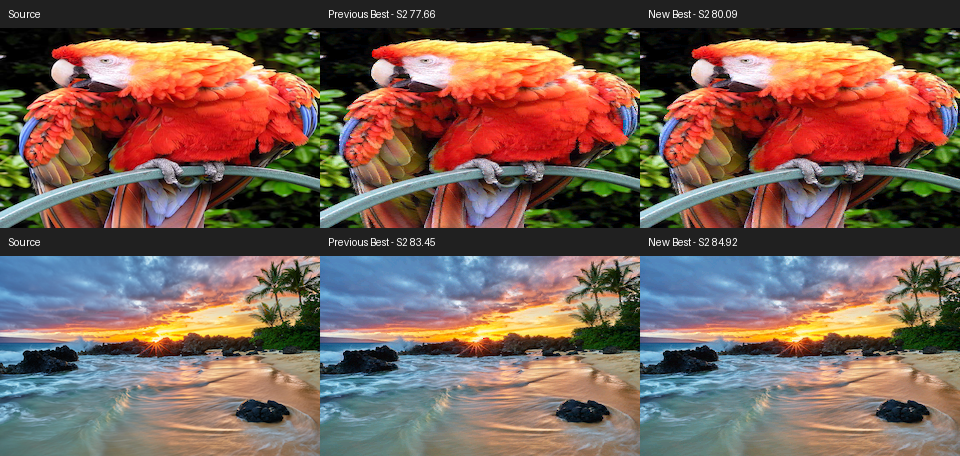

# nibnib encoder seed experiment

This experiment keeps the original nibnib file layout and decoder. It explores
palette initialization rather than changing the format.

The old Best sweep starts from raster-spaced samples, shifted between fits.
The new seed uses deterministic k-means++ sampling of six-component pair
deltas. It starts at zero and samples subsequent deltas in proportion to
their squared distance from existing centers. Green-field distances are
halved because RGB565 has twice as many green levels. This covers distinct
color changes without simply taking the largest outliers.

The ablation also tried square-root distance weighting (`gentle`) and fitting
again from the old Best palette (`warm`). Neither consistently beat squared
distance weighting. Results are in `screening.json`.

The initial implementation added one source-scored diverse fit to Best.
It retains the lowest-error narrow-beam palette across the fit's iterations,
screens it with a 64-state row search, and refines/searches at 256 states only
if that decoded screen improves SSIMULACRA2. The complete previous Best
result, including its refinement, remains a candidate. Ordinary encoding
was unchanged in that initial stage. Extra quality costs extra Best work;
this was not a speedup. The normal-mode follow-up below changes that tradeoff.

The fixed format means file sizes and decoder cost are unchanged.
`results.json` records final Best scores and independently checked round
trips for four cases. These are exploratory quality comparisons, not a new
full benchmark. All use Floyd–Steinberg strength 0.76, error clamp 0.12 and
Lanczos-3 resizing, matching the previous decoder experiments.

| Image | Size | Previous Best S2 | New Best S2 |
| --- | --- | ---: | ---: |
| macaw | 160×100 | 52.91 | 58.69 |
| logo | 160×100 | 40.32 | 40.32 |
| macaw | 320×200 | 77.66 | 80.09 |
| makena | 320×200 | 83.45 | 84.92 |

The logo retains the old Best file byte for byte. Eight focused native tests
pass, covering CLI/API equivalence, independent decoding, dithers, tiny
literal-only rows, padding and invalid inputs.

One sequential native timing comparison on the 320×200 macaw measured
27.78 seconds before and 31.06 after (about 12% longer). This is a single
machine/sample, not a general runtime claim. During that Best-only stage,
an ordinary 160×100 macaw encode also matched the pre-change file byte for byte.



Build the ablation from an existing native Ninja tree:

```sh
python3 experiments/nibnib-encoder/build.py
/tmp/nibnib-encoder/seed-sweep examples/macaw.jpg \
  /path/to/old-best-160x100.nibnib /tmp/nibnib-encoder/macaw 160 100
```

The baseline file must come from before the encoder change, with matching
dimensions and settings. Its palette supplies the warm-start control.
An optional final beam argument restricts the ablation to the diverse/source
candidate, useful for checking the cheaper screening search:

```sh
/tmp/nibnib-encoder/seed-sweep examples/macaw.jpg \
  /path/to/old-best-160x100.nibnib /tmp/nibnib-encoder/macaw64 160 100 64
```

A right-pixel-distance cache was also tested. It produced a byte-identical
file but was slower in the initial native comparison, so it was discarded.

## Normal-mode follow-up

Normal mode now uses the same diverse, source-scored fit and best fitting
checkpoint, followed by a single 64-state search instead of the old 256-state
search. It does not run the extra Best candidates or S2 selection. Best
includes this exact normal candidate, so it retains normal as a fallback.
Source OKLab values are reused for the reported quantization error. Seed
generation stops once all distinct deltas are covered, repeating the last
word exactly as the old full initialization would have done.

On eight cases, quality improved while encoding ran 1.5–2.1× faster. All
outputs passed independent pixel-exact decoding checks and retained their
old file sizes. Timings are sequential native measurements on one machine.
Settings and full results are in `normal-results.json`.

| Image | Size | Old normal S2 | New normal S2 | Speedup |
| --- | --- | ---: | ---: | ---: |
| macaw | 160×100 | 49.71 | 55.71 | 2.03× |
| logo | 160×100 | 32.83 | 39.60 | 1.84× |
| macaw | 320×200 | 75.24 | 78.96 | 1.69× |
| makena | 320×200 | 81.66 | 84.25 | 1.53× |
| jungle | 320×200 | 77.43 | 79.51 | 1.54× |
| shooter | 160×100 | 50.04 | 50.66 | 2.07× |
| brick | 160×100 | 85.12 | 87.47 | 1.68× |
| gradient fixture | 96×72 | 83.64 | 88.32 | 1.61× |

`normal_bench.py` accepts two versions of the included native encoder harness
(`input prefix width height`). Build both versions, then run:

```sh
python3 experiments/nibnib-encoder/build.py --source encode \
  --revision v1.120.0 --out /tmp/nibnib-before
python3 experiments/nibnib-encoder/build.py --source encode --out /tmp/nibnib-after
python3 experiments/nibnib-encoder/normal_bench.py \
  --before /tmp/nibnib-before/normal-encode --after /tmp/nibnib-after/normal-encode
```
